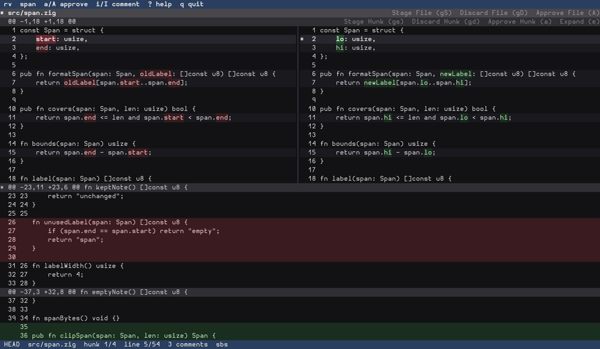
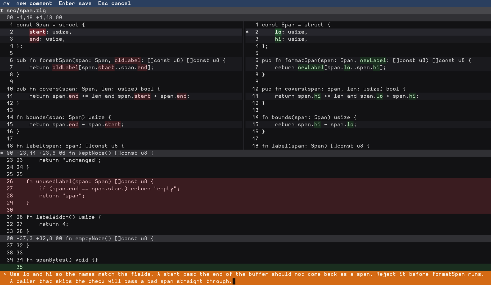
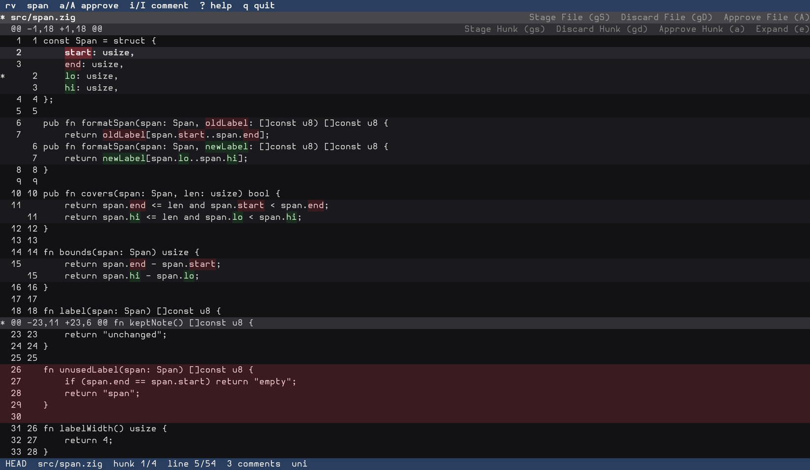
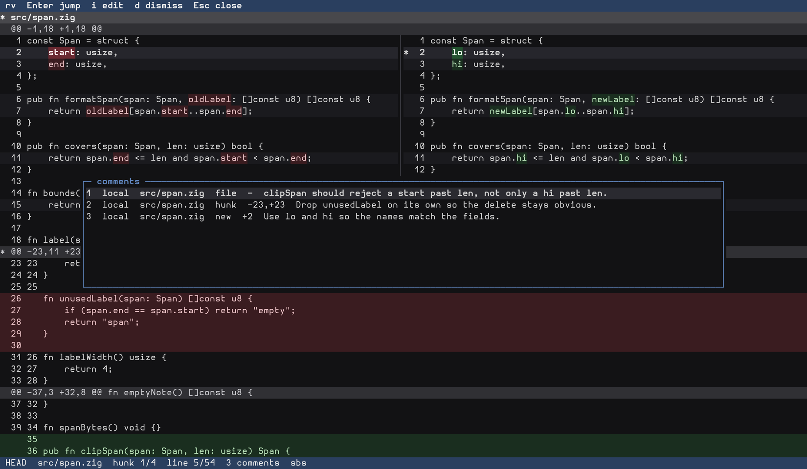
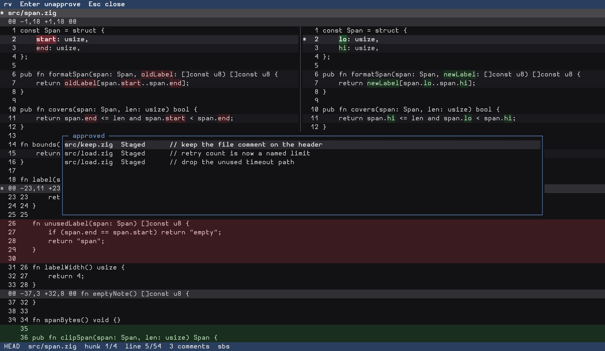

# rv

**Local terminal diff review for humans.**

Open `rv` on your local changes. Approve the changes you like, and comment on the changes you have feedback on. Tell your agent to address your rv comments. Reload with `r` and continue until you are happy with the changes.

## Install

Linux and macOS. No Windows builds yet.

### mise

```sh
mise use -g github:Zooce/rv
```

A specific release. Drop the leading `v` from the tag (`2.5`, or an older tag such as `2.2.0`):

```sh
mise use -g github:Zooce/rv@2.5
```

### install.sh

```sh
curl -fsSL https://raw.githubusercontent.com/Zooce/rv/master/install.sh | sh
```

Puts `rv` in `~/.local/bin`. A specific release (`v2.5`, or an older tag such as `v2.2.0`):

```sh
curl -fsSL https://raw.githubusercontent.com/Zooce/rv/master/install.sh | RV_VERSION=v2.5 sh
```

If `~/.local/bin` is not on `PATH`:

```sh
export PATH="$HOME/.local/bin:$PATH"
```

Install the agent skill after either method above:

```sh
npx skills add Zooce/rv -g
```

### From source

Zig 0.17.0.

```sh
zig build -Doptimize=ReleaseSafe --prefix ~/.local
npx skills add Zooce/rv -g
```

`rv --version` prints `major.minor` (zon `2.5.0` prints `rv 2.5`).

Load, paint, present, and approve timings: `mise run bench`. Compare a run to `bench/baseline.json` with `--compare`. How timings are taken, and how to attach `samply` or `perf`, is in [bench/README.md](bench/README.md).

## Screenshots

### Side-by-side diff

Changed words are colored on the line. Unchanged words on that line stay grey. A whole line that was added or deleted stays green or red.



### Writing a comment

`i` opens the comment box under the diff. The box grows as the comment wraps.



### Unified diff

`t` shows the same review as a unified diff.



### Comment list

`Space` then `c` lists open comments.



### Approved list

`Space` then `a` lists approved hunks. Approving stages a hunk and hides it from the diff.



## Use

```sh
rv                 # local changes (staged, unstaged, untracked)
```

`j` and `k` move the current line. A click jumps to that line. The scroll wheel moves the window and leaves that line selected. Shift+wheel, or a sideways trackpad scroll, pans the hunk under the pointer. `a` approves the hunk at that line and `A` approves the whole file. Approving stages the change and hides it from the diff. `i` or `Enter` comments on the current line. Press `?` for every key, and `q` to quit.

Tell your agent to address your rv comments. The skill from the install step reads those comments, edits the code, and resolves each comment it has handled. What you approved stays staged and stays out of the next diff.

`r` reloads the diff and the comments. Continue until you are happy with the changes.

```sh
rv HEAD            # one commit
rv main...HEAD     # a range
```

```sh
rv list            # open comments
rv export          # those comments as markdown
rv resolve <id>    # drop an addressed comment
rv approved        # hidden hunks and files
rv unapprove <n>
```

`rv` keeps your approvals and your comments. Your agent changes the code.

## Config

Display defaults are read once, before the first paint.

The user file is `$XDG_CONFIG_HOME/rv/config`. When `XDG_CONFIG_HOME` is unset or empty, it is `~/.config/rv/config`. The repo file is `.rv/config`, in the same directory as comments and approvals. A key in the repo file overrides that key in the user file. A missing file leaves the compiled default in place: side-by-side, line numbers on, wrap off.

```
layout = uni
line_numbers = false
wrap = true
```

`layout` is `side-by-side`, `sbs`, `unified`, or `uni`. `line_numbers` and `wrap` are `true` or `false`. An invalid file prints its path and the reason, and `rv` does not start.

`t`, `#`, and `w` change layout, line numbers, and wrap for this session. They do not write either file. The next `rv` reads the files again.

`rv list`, `rv export`, and the other headless commands do not read these files.

## Releases

Pushing a git tag `v<major>.<minor>` (zon `2.3.0` is tag `v2.3`) publishes a GitHub Release with Linux and macOS tarballs (x86_64 and aarch64) and SHA256 checksums. The Linux binaries are musl builds. The release name is the tag. The tag message is the release notes.

`mise use github:Zooce/rv` installs those tarballs: `rv-linux-x86_64.tar.gz`, `rv-linux-aarch64.tar.gz`, `rv-macos-x86_64.tar.gz`, and `rv-macos-aarch64.tar.gz`. Each archive contains `bin/rv`.

1. Bump `.version` in `build.zig.zon` to `major.minor.0` (for example `2.3.0`).
2. Commit that change.
3. Tag `v<major>.<minor>`: `git tag -a v2.3`
4. Push the tag: `git push origin v2.3`

The release action checks that the tag matches `build.zig.zon` and `rv --version`, then publishes the Release.

## License

MIT. See [LICENSE](LICENSE).
